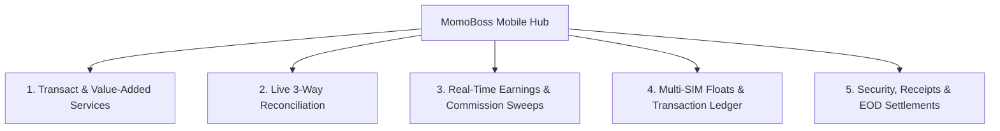

# MomoBoss

> **The Premier POS & Reconciliation Operating System for Mobile Money Agents in Africa.**

[](https://flutter.dev)
[](https://developer.android.com)
[](#)

---

## Overview

**MomoBoss** is an all-in-one mobile money agent point-of-sale (POS), universal USSD automation, and real-time ledger reconciliation application. Designed specifically for Ghana's multi-carrier telecom ecosystem (MTN MoMo, Telecel Cash, AT Money, and G-Money), it eliminates paper record-keeping, prevents drawer cash shortages, and automates tedious USSD dialing.

---

## Core Features



### 1. Universal Multi-Step USSD Automation
- **Native Android Accessibility Service**: Intercepts dialog prompts, navigates paginated menus, auto-fills transaction amounts, customer phone numbers, and reference tokens up to the PIN prompt.
- **Samsung One UI Support**: Custom heuristics for Samsung system dialers and modal prompts.
- **Dual-SIM Slot Auto-Routing**: Automatically directs `*171#` calls through SIM 1 (MTN) and `*110#` calls through SIM 2 (Telecel).

### 2. Real-Time SMS Capture & Strict Carrier Parser
- **BroadcastReceiver (`SMS_RECEIVED`)**: Captures carrier confirmation messages with priority 999.
- **Strict Verification Engine**: Extracts transaction reference, amount, fee, and customer phone while strictly rejecting balance inquiries, MMI timeouts, and promotional SMS.
- **60-Second Post-Session Poller**: Automatically tracks carrier SMS delays after USSD sessions finish.

### 3. Shift Auditing & 3-Way Reconciliation Engine
- **Live Cash vs. Float Variance Computation**: Cross-references physical cash counted in the shop drawer against recorded inflows, outflows, and float balances.
- **AI Audit Diagnosis**: Instant plain-language analysis of shortages, overages, or balanced shifts.
- **Shift Closing & EOD Settlement Reports**: Locks transactions, generates immutable settlement records, and prints/shares thermal summary slips.

### 4. Value-Added Services & Bill Payments Hub
- **Airtime Top-Up**: 3.0% commission rate.
- **Data Bundles**: 4.0% commission rate.
- **Utility Bills**: ECG Electricity & Ghana Water (GWCL) payments.
- **Pay TV**: DSTV, GOtv, StarTimes subscriptions.
- **Bank Transfers**: GhIPSS instant bank deposits (0.6% commission).

### 5. Commission Analytics & Automated USSD Sweep
- **Real-Time Earnings Dashboard**: Tracks today, weekly, monthly, and all-time earnings with daily milestone goal bars.
- **Automated USSD Sweep**: 1-tap transfer of accumulated SIM commission to Main Float or Personal MoMo Wallet.
- **Visual Analytics**: 7-day transaction volume bar charts and network revenue share donut charts (`fl_chart`).

### 6. Thermal POS Printing & Digital WhatsApp Receipts
- **ESC/POS 58mm / 80mm PDF Printing**: Standardized physical receipt layout with store header, agent code, barcode, and transaction details.
- **Digital Sharing**: Share formatted PDF receipts or clean text summaries directly to customer WhatsApp/SMS.

### 7. Biometric App Lock & Balance Privacy Shield
- **Biometric / PIN Gate**: Protects shop funds and ledger history with Fingerprint / Face ID / PIN.
- **Balance Privacy Shield**: 1-tap over-the-counter balance masking (`GHS ••••••`) to prevent walk-in customer peering.

### 8. Customer Directory & Smart Ghana Phone Suggestion
- **Auto-Learning Directory**: Contacts auto-save from confirmed transaction records.
- **Smart Phone Normalization**: Automatically converts `+233`, `233`, and local formats into standard 10-digit local format (`054XXXXXXX`).
- **Live Typing Auto-Suggest**: Instant customer search and auto-selection of matching telecom till.

---

## Tech Stack & Architecture

- **Framework**: Flutter 3.x / Dart
- **Architecture**: Provider (ChangeNotifier) Pattern
- **Native Android**: Kotlin (`FlutterFragmentActivity`, `AccessibilityService`, `BroadcastReceiver`)
- **Persistence**: `SharedPreferences` (JSON Model Serialization)
- **Printing**: `pdf` & `printing` (ESC/POS 58mm/80mm)
- **Charts**: `fl_chart`
- **Security**: `local_auth` (Biometric Fingerprint & PIN)
- **Fonts**: Google Fonts (`Plus Jakarta Sans`)

---

## Project Structure

```
lib/
├── main.dart                      # App Shell, 4-Tab Navigation & Lifecycle
├── models/
│   └── momo_models.dart           # Data models (Till, Transaction, Shift, Contact, Rules)
├── providers/
│   └── momo_provider.dart         # Central State Manager & Reconciliation Engine
├── services/
│   ├── ussd_service.dart          # MethodChannel bridge for USSD dialing & SIM routing
│   ├── sms_parser_service.dart    # Strict telecom message regex parser
│   ├── storage_service.dart       # SharedPreferences persistence layer
│   ├── receipt_service.dart       # ESC/POS 58mm thermal receipt & PDF generator
│   ├── security_service.dart      # LocalAuthentication biometric lock
│   └── phone_helper.dart          # Ghana phone normalization & network detection
├── screens/
│   ├── transact_screen.dart       # Cash In/Out & Embedded Services Switcher
│   ├── services_screen.dart       # Airtime, Data, ECG, Water, TV, Bank Transfer Hub
│   ├── reconciliation_screen.dart # Shift Audit, SMS Scanner, EOD Settlement & History
│   ├── commissions_screen.dart    # Earnings, Goal Target, USSD Sweep & Charts
│   ├── tills_screen.dart          # Multi-SIM Working Float & Till Manager
│   ├── ledger_screen.dart         # Searchable Transaction Journal & Receipts
│   ├── customer_test_screen.dart  # Customer Test Lab (*170# Sandbox)
│   └── settings_screen.dart       # Security, Privacy & Network Commission Rules
└── widgets/
    └── top_toast.dart             # Non-intrusive floating progress alert overlay
```

---

## Building and Running

### Prerequisites
- Flutter SDK (3.24+)
- Android SDK with platform-tools (`adb`)
- Android 8.0+ (API level 26+) physical device with SIM card(s)

### Setup Instructions
```bash
# 1. Clone the repository
git clone https://github.com/kodetech/momoboss.git
cd momoboss

# 2. Install dependencies
flutter pub get

# 3. Enable Accessibility Service on Device
# Settings -> Accessibility -> Installed Services -> MomoBoss -> Enable

# 4. Run on connected device
flutter run -d <device-id>
```

---

## Author & Copyright

**KODETECH Solutions**  
*Empowering African Mobile Money Agents with Next-Generation POS Intelligence.*
